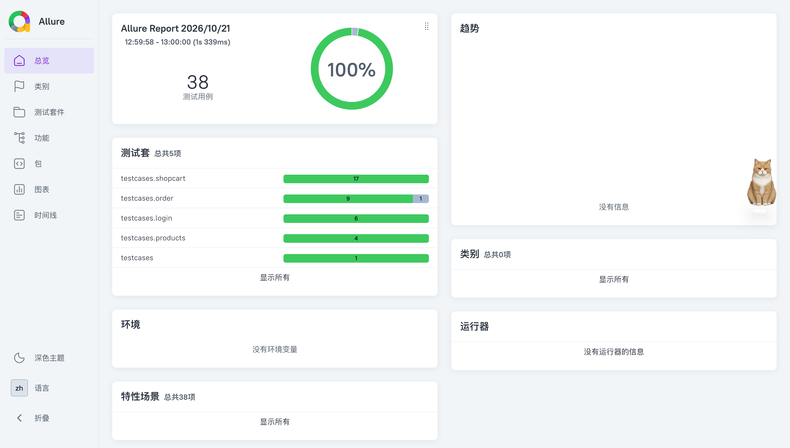
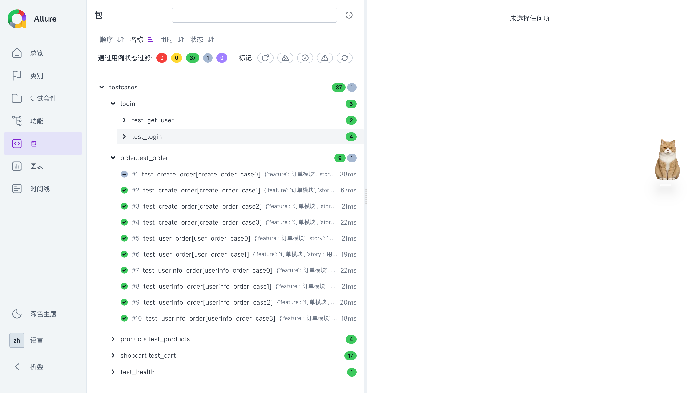
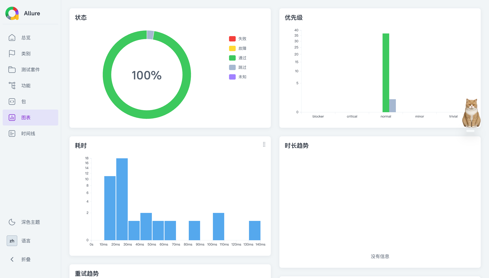

# 商城 API 自动化测试

基于 `pytest`、`requests` 和 YAML 测试数据的商城接口测试项目。用例覆盖健康检查、登录与用户信息、商品、购物车和订单接口；断言由 `commons/assert_util.py` 统一处理。`make test-only` 生成本地 Allure 报告，`make test` 还会将报告发布到 Allure Report Storage。

## 环境要求

- Python 3.11（当前项目使用的版本）
- 可访问测试接口的网络环境
- `make` 和 Allure Report 3 命令行工具；运行 `allure --version` 应显示 3.x
- 发布报告时，本机还需能访问 Allure Report Storage 服务

`requirements.txt` 包含 pytest、Allure pytest 插件、PyYAML 等依赖；`requests` 由 `pytest-base-url` 的依赖一并安装。

## 快速开始

在项目根目录执行：

```bash
python3 -m venv .venv
source .venv/bin/activate
make install
```

`data/login/test_login.yaml` 和 `data/login/test_get_user.yaml` 已包含登录、用户信息用例及账号占位符。按测试环境调整接口地址和预期结果，不要把真实账号或密码写入 YAML。

在项目根目录创建 `.env`，填写测试账号：

```dotenv
SMALL_U1_EMAIL=你的测试邮箱
SMALL_U1_PASSWORD=你的测试密码
```

`read_yaml` 读取用例时会替换 `${SMALL_U1_EMAIL}`、`${SMALL_U1_PASSWORD}` 等占位符；同名的 shell 环境变量优先于 `.env`。`${token}` 会留到登录后由测试代码填入。

`make install` 只安装 Python 依赖。Allure Report 3 需要单独安装，并确保 `allure` 命令指向 3.x；例如已安装 Node.js 和 npm 时，可运行 `npm install -g allure`。

项目中的其他 YAML 用例目前使用完整接口 URL；切换测试环境时，需要同步修改这些 URL。`pytest.ini` 中的 `base_url` 不会自动替换 YAML 里的完整 URL。请从项目根目录运行命令，因为代码按相对路径读取测试数据。

## 运行测试

```bash
# 运行全部用例，并在 reports/ 生成本地 HTML 报告；默认不上传
make test-only

# 运行全部用例、生成报告，并发布到 Allure Report Storage
make test

# 仅运行指定用例：只写入 temps/，不会生成 HTML 报告或上传
python -m pytest -m smoke
python -m pytest testcases/products/test_products.py
```

`pytest.ini` 默认开启 `--alluredir=./temps --clean-alluredir`，每次运行都会清理上一次的原始结果。两个 Make 目标都会在 pytest 通过或仅有用例失败时生成报告；如果用例失败，`make` 最终仍返回失败状态。购物车和订单用例可能创建或修改测试数据，建议使用专用测试环境和账号。

### GitHub Actions

`.github/workflows/api-tests.yml` 在推送到 `main` 或手动触发时，先在 GitHub 托管 runner 上构建测试镜像并推送到腾讯云容器镜像服务（TCR），镜像标签为提交 SHA。随后 Linux x64 自托管 runner 拉取该镜像，在容器内运行 `make test`：执行 pytest、生成 Allure 报告并发布到 Allure Report Storage；报告也会保存为 GitHub Actions 构建产物。自托管 runner 需要 Docker，无需在宿主机安装 Python、Node.js 或项目依赖。

运行前在仓库的 **Settings → Secrets and variables → Actions** 中配置：

- Repository variable `TCR_IMAGE_REPOSITORY`：完整镜像仓库地址，不含标签。例如个人版 `ccr.ccs.tencentyun.com/命名空间/仓库名`；企业版使用控制台提供的 `<实例名>.tencentcloudcr.com/命名空间/仓库名`。
- Repository secrets `TCR_USERNAME`、`TCR_PASSWORD`：该仓库的 Docker 登录凭据，需有推送和拉取权限。企业版的 CI 可使用服务级账号。
- Repository secrets `SMALL_U1_EMAIL`、`SMALL_U1_PASSWORD`、`ALLURE_SERVICE_ACCESS_TOKEN`：测试账号和下文说明的 `ars1.` 报告令牌。

工作流从镜像地址提取登录域名，用 TCR 凭据推送和拉取。测试账号和报告令牌只在运行容器时注入，不写入镜像。GitHub 托管 runner 和自托管 runner 都要能访问 TCR；自托管 runner 还需能访问测试接口和 Allure Report Storage。报告令牌内嵌的服务地址也必须能从测试容器访问。如果签发令牌时用了 `localhost:3000`，应先为报告服务设置容器可访问的 `PUBLIC_URL`，再重新签发令牌。

查看本地报告：

```bash
allure open ./reports
```

### 发布报告的令牌

`make test` 会设置 `ALLURE_SERVICE_PUBLISH=true`，`allurerc.mjs` 因此使用项目根目录 `.env` 中的报告访问令牌。先用部署 Allure Report Storage 时设置的 **bootstrap `ACCESS_TOKEN`** 签发令牌：

```bash
curl -X POST 'http://<storage-host>:3000/api/token' \
  -H 'Authorization: Bearer <bootstrap ACCESS_TOKEN>'
```

取得 `ars1.` 开头的令牌后，在项目根目录的 `.env` 中追加：

```dotenv
ALLURE_SERVICE_ACCESS_TOKEN=ars1.替换为签发的报告访问令牌
```

`make test-only` 默认不发布，也不要求令牌。不要在 `.env` 或当前 shell 中设置 `ALLURE_SERVICE_PUBLISH=true`，否则它也会尝试发布。`.env` 已被 Git 忽略，不要将真实令牌写入 README 或提交到仓库。此发布流程连接的是 **Allure Report Storage**，不是 Allure Docker Service UI。

## 项目结构

```text
commons/                  请求、YAML 读取和断言工具
data/                     接口测试数据（YAML）
  login/                  登录与用户信息；YAML 使用账号占位符
  products/               商品用例
  shopcart/               购物车用例
  order/                  订单用例
testcases/                pytest 测试代码与登录 token fixture
pytest.ini                pytest 配置与冒烟标记
makefile                  本地报告与发布报告的运行入口
Dockerfile                测试镜像定义
.dockerignore             构建镜像时排除本地凭据和生成文件
allurerc.mjs              Allure 3 报告及发布配置
.env                      本地账号变量和报告访问令牌（不提交）
run.py                    旧的测试及报告生成入口；建议使用 make
temps/                   Allure 原始结果（运行时生成）
reports/                 Allure HTML 报告（运行时生成）
extract.yaml             登录后生成的 token（运行时生成）
```

## 测试数据与断言

测试方法通过 `pytest.mark.parametrize` 加载对应的 YAML 文件。一个用例通常包含 `request` 和 `validate`：

```yaml
- feature: 健康检查模块
  story: 健康检查接口
  title: 验证成功
  request:
    methods: get
    url: https://your-test-api.example/api/health
    headers: null
  validate:
    - eq: ["status_code", 200]
    - eq: ["json.status", "ok"]
```

`validate` 支持 `eq`、`ne`、`gt`、`lt`、`contains` 和 `len_eq`。取值路径可使用 `status_code`、`text` 或 `json.字段.子字段`。需要认证的用例在请求头中使用 `Bearer ${token}`；会话级 `auth_token` fixture 从本地登录 YAML 找到带 `extract` 的用例，登录后将 token 注入请求头。

## 本地数据与 Git

`.gitignore` 忽略 `.env`、运行时的 `extract.yaml`、虚拟环境、缓存及 Allure 生成目录。登录 YAML 可以提交，但只应包含占位符；不要把真实账号、密码或 token 写入仓库。

如果敏感文件在设置忽略规则前已经被 Git 跟踪，`.gitignore` 不会自动取消跟踪；需要单独从 Git 索引移除，并检查是否已推送到远端。

## 部分allure截图




